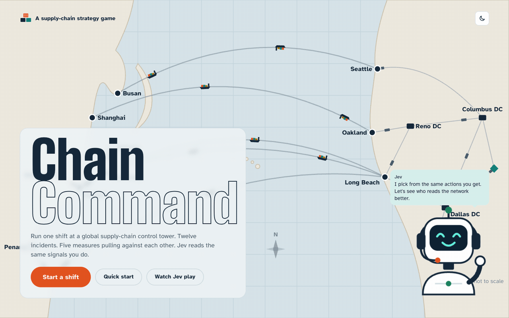
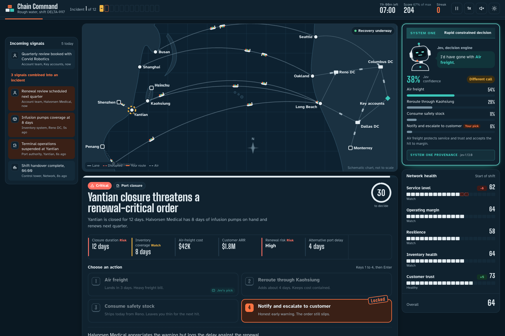
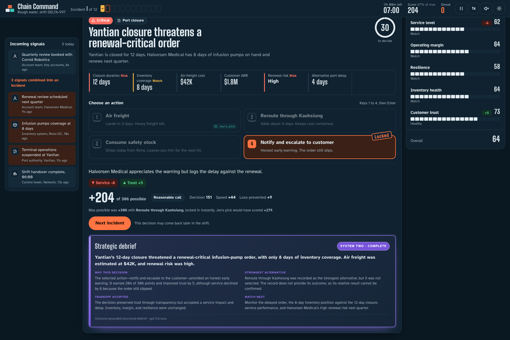

# Chain Command

Chain Command makes one contrast tangible: a human works through one genuinely hard supply-chain decision under pressure, while System One applies the same bounded decision pattern across hundreds of rows per second. System Two stays off the critical path and explains the consequential outcomes.

The default public experience is a self-contained replay with two paths:

1. **Try the hard decision** opens one Storm-season incident with the full evidence, network state, operational tradeoffs, and a human decision clock.
2. **Compare human vs AI speed** opens a Human / AI toggle and animates one second at the recorded Jev Choice rate. The source benchmark completed 1,000 decisions in a median 0.515 seconds, or about 1,943 decisions per second, using batch size 100 and concurrency 10.

The live provider mode retains the complete 12-incident control-tower game with a live signal feed, animated ships, trucks and aircraft, carry-forward consequences, autopilot, network-health views, a decision log, and a final scorecard.

System One and System Two have distinct jobs:

1. **System One** reads the incident, evidence, current network state, recent decisions, four offered actions, and weighted criteria. It picks one valid action and returns calibrated confidence and probabilities.
2. The artifact’s **deterministic game engine** applies that action’s operational effects, points, follow-on events, and network animation.
3. **System Two** receives the chosen action, deterministic consequence, metric changes, achieved and maximum scores, strongest alternative, and resulting network state. It writes the strategic debrief shown under the incident.



*Captured from a live run using TypeSafe Jev for the bounded decision and OpenAI for the outcome-grounded strategic debrief.*

### System One: rapid constrained decision

System One evaluates the live operational evidence and ranks only the actions the simulator can execute. In this scenario it recommends air freight while the player deliberately locks the lowest-probability action.



### System Two: outcome-grounded strategic debrief

After the deterministic engine applies the selected action, System Two explains the recorded outcome, accepted tradeoff, strongest alternative, and signals to watch next.



*Deliberate disagreement: System One recommended air freight while the player locked “Notify and escalate.” The deterministic engine scored the player’s choice at 204 of 306 and reduced service by eight points. System Two then explained the tradeoff and identified rerouting through Kaohsiung as the strongest unselected alternative.*

## Play the static replay

Open `index.html` directly or serve the directory from any static host. The default mode is a self-contained interactive replay. The human challenge uses one hard incident; the scale view compares one human decision with a one-second simulation at the recorded Jev rate. The representative System One response was captured from Jev 1.13.0. If the player chooses “Notify and escalate,” the System Two debrief is the corresponding captured gpt-5.6-luna response over the deterministic outcome. Other choices receive deterministic embedded debriefs so every branch remains playable. No provider is contacted by the public page, no credential is needed, and no inference cost is incurred.

The interface labels both stages as replayed responses so the public demo does not imply that it is running live inference.

The captured provider outputs are checked in under [`captures/`](captures/) for inspection.

## Run it with live providers

Requirements: a C++17 toolchain, libcurl, Git, [uv](https://docs.astral.sh/uv/), and credentials for the two configured providers.

```bash
export TYPESAFE_API_KEY="..."
export OPENAI_API_KEY="..."
./examples/chain-command/run.sh
```

The launcher:

- stops immediately when either credential is absent;
- installs the pinned Python environment with `uv`;
- builds the native DuckDB extension when its artifact is absent;
- creates a local DuckDB connection and provider secret in memory;
- opens `http://127.0.0.1:8787/?live=1` in the default browser.

No credential is sent to the browser or written to disk. The server binds only to loopback. Override `TYPESAFE_MODEL`, `OPENAI_MODEL`, or `CHAIN_COMMAND_PORT` through environment variables. Set `CHAIN_COMMAND_OPEN_BROWSER=0` to suppress automatic browser launch.

Provider calls may incur charges. Exact incident replays use the extension’s per-connection cache. The UI identifies recalled results without changing their provenance.

## Live game behavior

- Three difficulty modes: Calm seas, Rough water, and Storm season.
- Twelve incidents drawn from 27 event families, with the representative Yantian closure first.
- Decisions can drain safety stock, freeze premium-freight budgets, activate backup suppliers, or create later quality and shutdown events.
- Jev can advise a human player or run the full shift in autopilot. Full-speed autopilot keeps System Two off the critical loop; manual decisions receive a strategic debrief.
- The scorecard compares the player, maximum possible score for the encountered incidents, and Jev’s decisions.
- Keyboard controls, screen-reader announcements, text labels for status colors, captions, and reduced-motion behavior are included.

The model does not mutate the game directly. System One can return only an offered action ID; the deterministic simulator owns all consequences. System Two explains the recorded outcome and must acknowledge when another action scored better.
